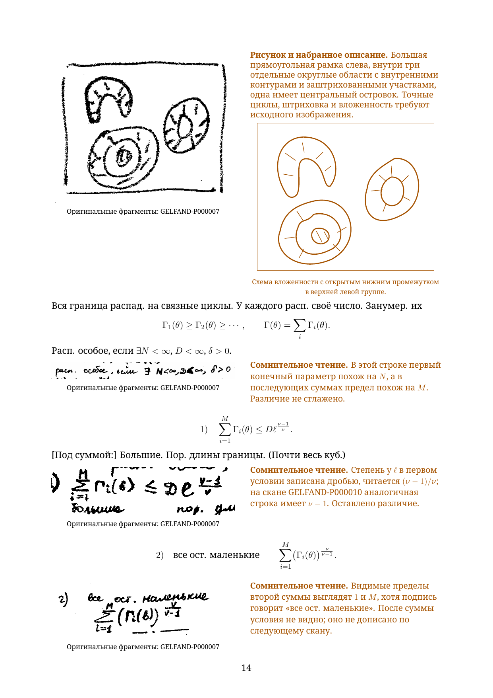
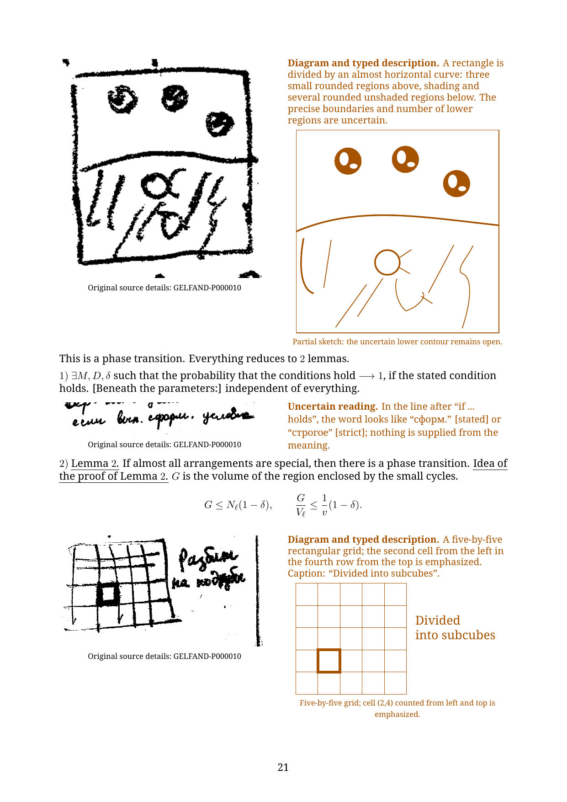

# Chapter 1: first ten source pages

This working excerpt begins at **GELFAND-P000001** and continues through **GELFAND-P000010**. The Russian diplomatic reader has **51 A4 pages** and the separate English translation has **50**. Each contains 22 pages of flowing transcription and 26 pages of full reading notes, followed by separate editorial mathematical commentary. **The complete chapter and both complete readers remain in preparation.**

- [Russian PDF](gelfand-russian-chapter01-first10-crops.pdf) · [Russian LaTeX](gelfand-russian-chapter01-first10-crops.tex)
- [English PDF](gelfand-english-chapter01-first10-crops.pdf) · [English LaTeX](gelfand-english-chapter01-first10-crops.tex)
- [All 63 full reading notes](reading-notes.json), [original crop locations](source-crops.json), and [editorial mathematical comparisons](editorial-mathematical-comparisons.json)

Every unclear or unreadable entry displays its actual original fragment beside the typed reading, in both the body and the full notes. All historical alternatives and notes remain available. Writing, formulas and readable diagram labels are typed; crops supplement them. The excerpt contains 94 distinct original crops.

The newly included pages add seven native diagram sketches and pair three existing native diagrams with their actual originals. Partial recreations are labelled explicitly. The left cell chain on source page 6 has unresolved internal divisions; its sketch preserves only the outer outline and hatching. The horseshoe opening on page 7, four nested boundaries on page 10, and five-by-five grid with its emphasized cell follow the inspected source. The uncertain lower contour in page 10's phase sketch remains open. A native recreation of the opening blow-up diagram remains unfinished.

Both PDFs compiled in two successful LuaLaTeX passes. All changed pages were visually inspected: 59 pages in the new PDFs; the remaining 42 reproduce the exact content pixels of previously inspected pages, apart from the renumbered footer. Newly included source pages were checked in the whole native originals and at 3×, 5× and 10×; clipped or mistargeted details were corrected. All 94 retained crops match original scan pixels, and all 362 embedded crop occurrences match those retained images. The first five source bodies retain the earlier checked text; added diagram and layout edits have checked inverses. Uncertain readings remain marked.

The mathematical commentary states its assumptions separately. It checks energy/perimeter counting, pressure signs, boundary scales, two possible convergence readings, ball constants, subcube averaging and a conditional evaluation-map explanation. These calculations do not establish ambiguous ink readings or prove the notes' thermodynamic-limit and phase-transition assertions.

Production continues from source page 11 in chapter 1, then in source order. [Whole-reader coverage](../../READERS-STATUS.md). The [earlier five-page excerpt](../chapter01-first5-working/README.md) is preserved.

To rebuild, run each source twice with LuaLaTeX and shell escape disabled, from this folder. Keep the figures folder alongside the source. The font declaration expects Noto Serif in the Windows fonts folder; other installations can select their installed Noto Serif through fontspec.
