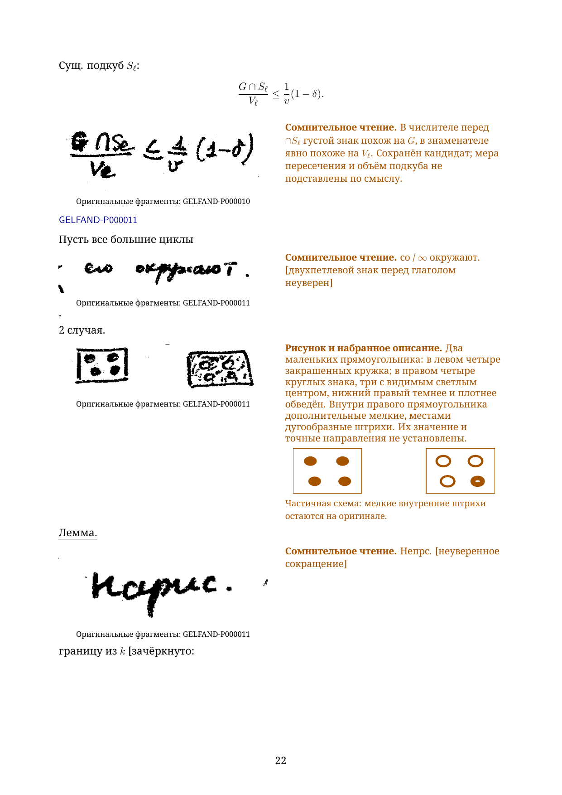
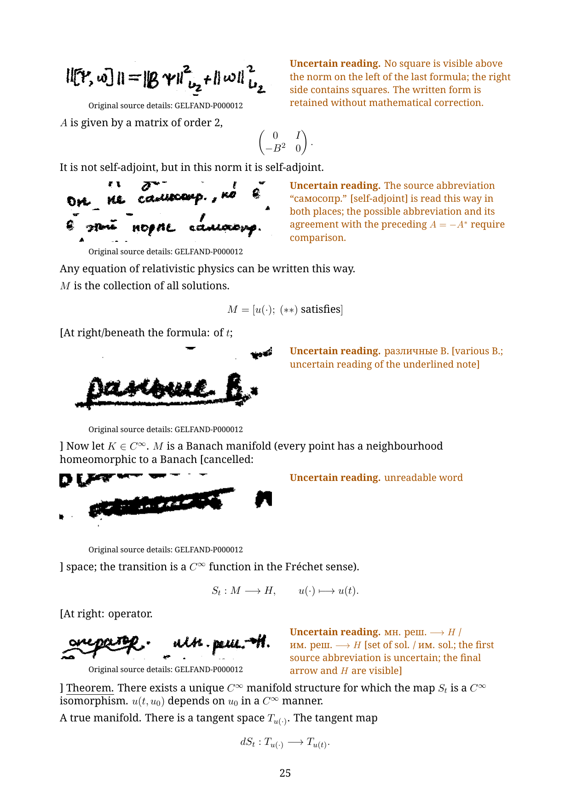

# Chapter 1: first fifteen source pages

This excerpt begins at **GELFAND-P000001** and continues through **GELFAND-P000015**. The Russian diplomatic reader has **72 A4 pages**; the separate English translation has **71**. Each contains 30 pages of flowing transcription and 38 pages of full reading notes, followed by separate mathematical commentary. **The complete chapter and both complete readers remain in preparation.**

- [Russian PDF](gelfand-russian-chapter01-first15-crops.pdf) · [Russian LaTeX](gelfand-russian-chapter01-first15-crops.tex)
- [English PDF](gelfand-english-chapter01-first15-crops.pdf) · [English LaTeX](gelfand-english-chapter01-first15-crops.tex)
- [All 91 reading notes](reading-notes.json), [original crop locations](source-crops.json), and [separate mathematical comparisons](editorial-mathematical-comparisons.json)

Every unclear or unreadable entry displays its actual original fragment beside the typed reading, both in the body and in the full notes. Historical alternatives and complete notes are retained. Prose, formulas and readable diagram labels are typed; the 132 distinct source crops supplement them. Source-page labels preserve reading order and allow comparison with the archive.

Native diagram sketches accompany the originals where available. Partial recreations are labelled explicitly: the cell chain on source page 6 has unresolved internal divisions; the phase drawing on page 10 has an uncertain lower contour; the two rectangles on page 11 retain four main marks each while small interior strokes remain visible in the original. A native recreation of the opening blow-up diagram remains unfinished.

The later pages discuss lattice paths, nonlinear evolution, variational equations, commutators and measures. Inconsistent notation and uncertain abbreviations remain as written. The separate commentary examines counting and displacement, a conditional finite matrix calculation, linearization and completed pushforward measures. It distinguishes these arguments from the manuscript reading and states what they do not establish.

Production continues from source page 16 in chapter 1, then in source order. [Whole-reader coverage](../../READERS-STATUS.md). The [earlier ten-page excerpt](../chapter01-first10-working/README.md) is preserved.

To rebuild, keep the figures folder beside the sources and run each source twice with LuaLaTeX, with shell escape disabled. Install the four Noto Serif TrueType faces (regular, italic, bold and bold italic), including Cyrillic letters and the mathematical minus sign. On Windows the font folder is obtained from the environment; elsewhere the font files must be discoverable by LuaLaTeX. The text uses standard LaTeX mathematics, TikZ, fontspec, graphicx, hyperref, needspace and ulem.
