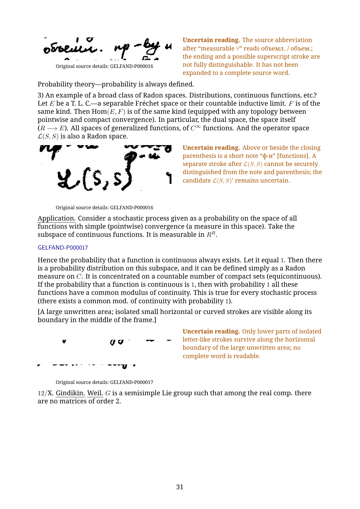
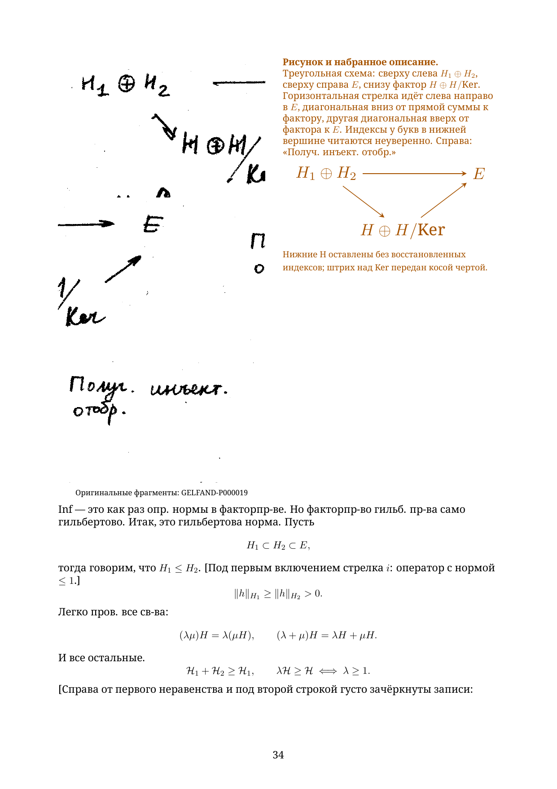

# Chapter 1: first twenty source pages

This excerpt begins at **GELFAND-P000001** and continues through **GELFAND-P000020**. The Russian diplomatic reader has **86 A4 pages**; the separate English translation has **85**. Each contains 36 pages of flowing transcription, followed by full reading notes and separate mathematical commentary. **The complete chapter and both complete readers remain in preparation.**

- [Russian PDF](gelfand-russian-chapter01-first20-crops.pdf) · [Russian LaTeX](gelfand-russian-chapter01-first20-crops.tex)
- [English PDF](gelfand-english-chapter01-first20-crops.pdf) · [English LaTeX](gelfand-english-chapter01-first20-crops.tex)
- [All 104 reading notes](reading-notes.json), [original crop locations](source-crops.json), and [separate mathematical comparisons](editorial-mathematical-comparisons.json)

Every unclear or unreadable entry displays its actual original fragment beside the typed reading, both in the body and in the full notes. The 103 historical records retain their complete notes and alternatives. One additional note shows the clipped letter remnants at the boundary of the blank area on source page 17; no word is supplied. Prose, formulas and readable diagram labels are typed; the 154 distinct source crops supplement them.

Native diagram sketches accompany the originals where available. Partial recreations are labelled explicitly: the cell chain on source page 6 has unresolved internal divisions; the phase drawing on page 10 has an uncertain lower contour; the two rectangles on page 11 retain four main marks each while small interior strokes remain visible in the original. The triangular diagram on page 19 has all three arrows and typed labels; uncertain lower indices remain unfilled. A native recreation of the opening blow-up diagram remains unfinished.

The later pages discuss Radon measures, stochastic processes, deformations and Hilbert subspaces. Inconsistent notation and uncertain abbreviations remain as written. The separate mathematical commentary explains the quotient norm, reciprocal scaling and the elementary cocycle calculation under explicit assumptions. It also distinguishes possible quantifiers in the common-modulus statement and the order-cone terminology. These arguments remain separate from the manuscript transcription.

Production continues from source page 21 in chapter 1, then in source order. [Whole-reader coverage](../../READERS-STATUS.md). The [earlier fifteen-page excerpt](../chapter01-first15-working/README.md) and earlier downloads remain available.

To rebuild, keep the figures folder beside the sources and run each source twice with LuaLaTeX, with shell escape disabled. Install the four Noto Serif TrueType faces (regular, italic, bold and bold italic), including Cyrillic letters and the mathematical minus sign. On Windows the font folder is obtained from the environment; elsewhere the font files must be discoverable by LuaLaTeX. The text uses standard LaTeX mathematics, TikZ, fontspec, graphicx, hyperref, needspace and ulem.
