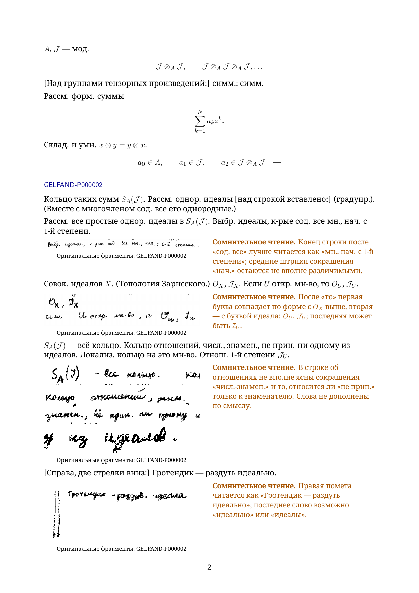

# Chapter 1: first three source pages

This working excerpt starts at **GELFAND-P000001** and continues through **GELFAND-P000003**. The Russian diplomatic reader and separate English translation each have **13 A4 pages**: five pages of flowing transcription, seven pages of full reading notes, and one page of explicitly separate editorial mathematics. **The complete chapter is still in preparation.**

- [Russian PDF](gelfand-russian-chapter01-first3-crops.pdf)
- [English PDF](gelfand-english-chapter01-first3-crops.pdf)
- [Russian LaTeX](gelfand-russian-chapter01-first3-crops.tex)
- [English LaTeX](gelfand-english-chapter01-first3-crops.tex)
- [All 19 full reading notes](reading-notes.json), [original crop locations](source-crops.json), and [editorial mathematical comparisons](editorial-mathematical-comparisons.json)

Every uncertain or unreadable entry shows the relevant original detail beside the typed reading. The notes retain the complete historical observations, alternative readings and assessments, together with fresh source comparisons. The simple cross on source page 3 appears beside its existing typeset recreation. The opening blow-up diagram has its source crop and typed description; a native recreation remains unfinished. Text, formulas and readable labels are typed; crops supplement them.

Both PDFs compiled successfully in two LuaLaTeX passes. All 26 final pages were visually inspected. Uncertain source regions were inspected at 3×, 5× and 10×; embedded source crops retain the original pixels. The six source-frame/language bodies were checked against the selected transcriptions after removing only the layout wrappers. This verifies this excerpt, not the full manuscript.

The last appendix explains an elementary local model of blowing up the origin and checks the nearest-neighbor pair count in finite lattice examples. It does not silently correct the handwritten minus/plus difference, U/u notation, partition-function arguments, or unreadable cancellations. It does not claim to prove the thermodynamic limit.

Production proceeds from chapter 1 in source order. Earlier chapter 30–31 working PDFs remain partial releases and require uncertainty-crop backfill. [Whole-reader coverage](../../READERS-STATUS.md). The earlier [single-source-page proof](../chapter01-opening-working/README.md) is preserved.

To rebuild, run each source twice with LuaLaTeX and shell escape disabled, from this folder. The `figures` folder is required. The font declaration expects Noto Serif in the Windows fonts folder; other installations can select the installed Noto Serif font with fontspec.
