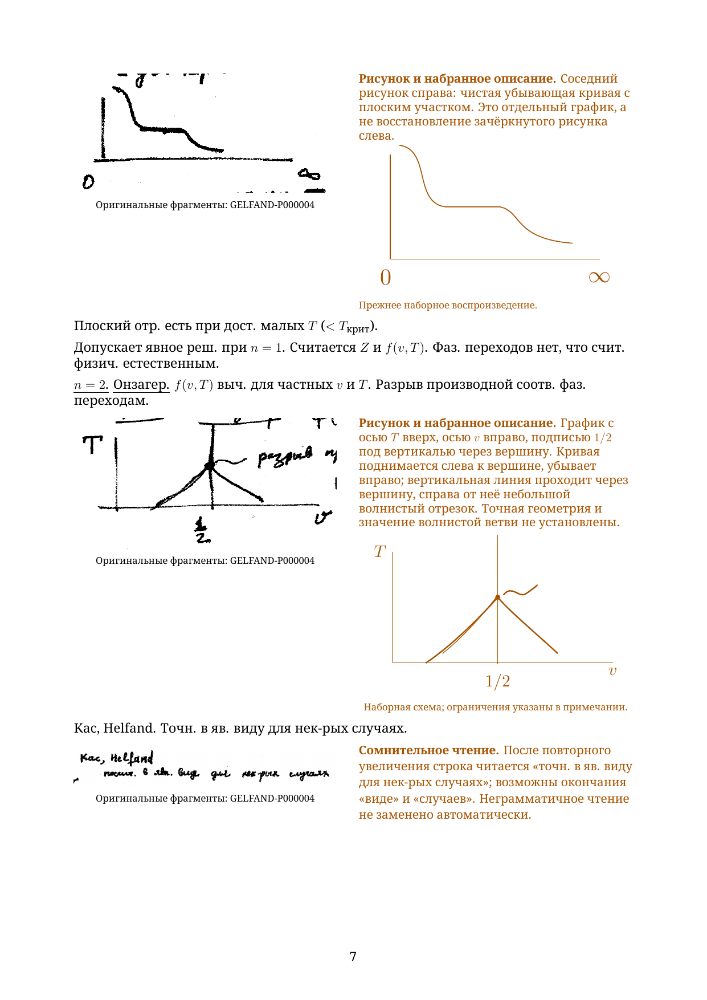
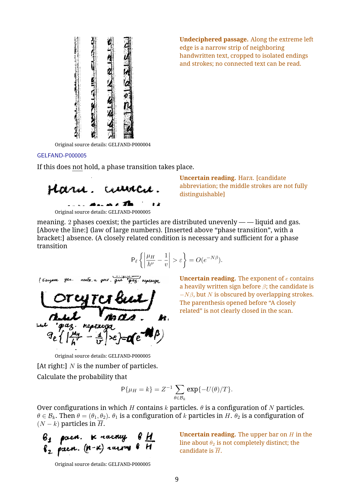

# Chapter 1: first five source pages

This working excerpt begins at **GELFAND-P000001** and continues through **GELFAND-P000005**. The separate Russian diplomatic reader and English translation each have **25 A4 pages**: 10 pages of flowing transcription, 14 pages of full reading notes, and one page of separate editorial mathematical commentary. **The complete chapter and both complete readers remain in preparation.**

- [Russian PDF](gelfand-russian-chapter01-first5-crops.pdf)
- [English PDF](gelfand-english-chapter01-first5-crops.pdf)
- [Russian LaTeX](gelfand-russian-chapter01-first5-crops.tex)
- [English LaTeX](gelfand-english-chapter01-first5-crops.tex)
- [All 33 full reading notes](reading-notes.json), [original crop locations](source-crops.json), and [editorial mathematical comparisons](editorial-mathematical-comparisons.json)

Every unclear or unreadable entry displays its actual original fragment beside the typed reading, both in the body and in the full notes. All historical alternatives and notes remain available. Writing, formulas and readable diagram labels are typed; crops supplement them.

All five drawings on source page 4 are included. The phase-transition curve, Onsager sketch and subcube have new native LaTeX sketches beside their originals. The heavily cancelled graph has a clearly labelled partial recreation of its secure axes; its underlying curves cannot be separated reliably from the cancellations. The existing clean pressure graph is now paired with its own original, rather than being associated with the cancelled drawing. The simple cross on source page 3 retains its original/native pairing. A native recreation of the opening blow-up diagram remains unfinished.

Both PDFs compiled in two successful LuaLaTeX passes. All 50 final pages were inspected. Uncertain regions on the newly included source pages were checked in the whole native originals and at 3×, 5× and 10×. All 196 embedded crop occurrences match retained original pixels. The first three source bodies match the prior checked excerpt; the four added source/language bodies have reversible diagram and layout edits. No uncertain reading was silently resolved.

The mathematical appendix gives an elementary blow-up chart model and finite nearest-neighbor checks, then derives the pressure sign and boundary-energy scale under explicit conventions. It distinguishes the bounded coefficient in a partition-sum ratio from the configuration variable. It does not claim to prove the thermodynamic limit or the phase-transition assertions, and it does not replace ambiguous ink with expected mathematics.

Production continues from source page 6 in chapter 1, then in source order. [Whole-reader coverage](../../READERS-STATUS.md). The [earlier three-page excerpt](../chapter01-first3-working/README.md) is preserved.

To rebuild, run each source twice with LuaLaTeX and shell escape disabled, from this folder. Keep the figures folder alongside the source. The font declaration expects Noto Serif in the Windows fonts folder; other installations can select their installed Noto Serif through fontspec.
